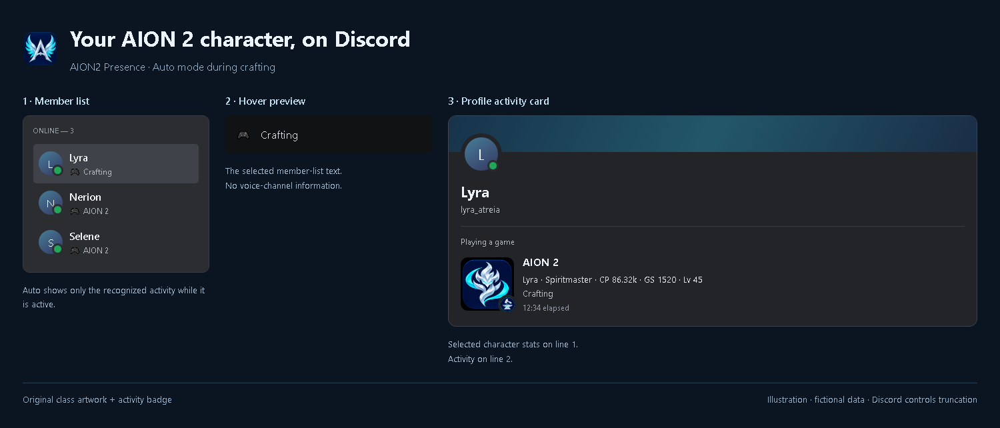
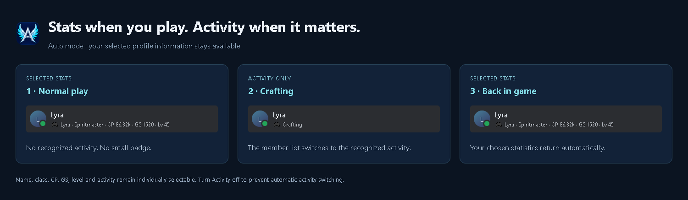
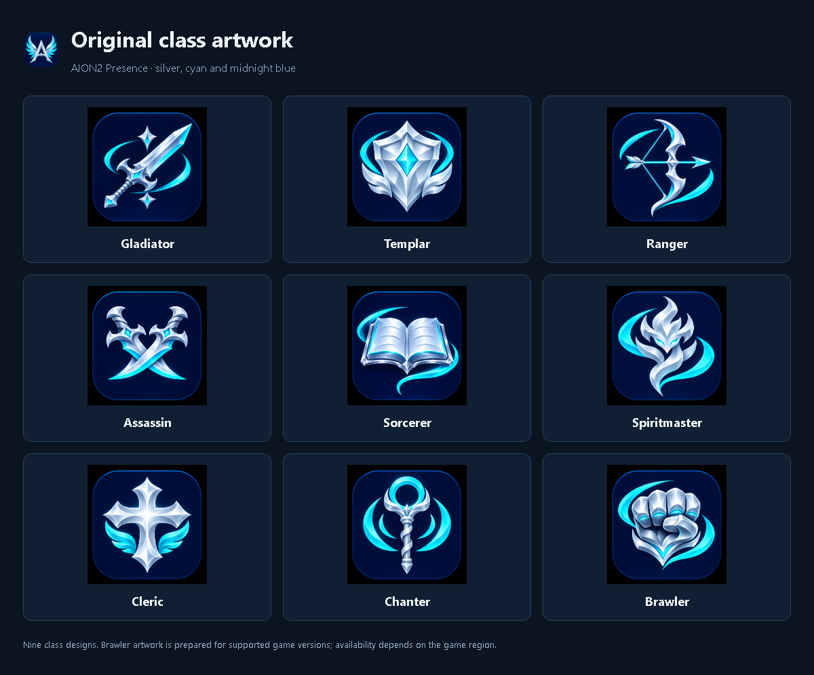
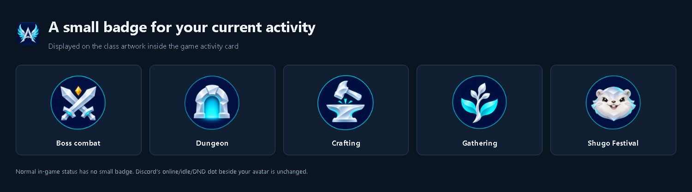

# AION2 Presence


[Polski](README.pl.md) | **English**

**Your AION 2 character and activity, on Discord.**

A free, open-source Windows app that shows your character stats and what you are doing in game. Runs independently in the background — no running DPS meter, Discord token or developer setup required.

**[Download for Windows](https://github.com/Kooowal-design/aion2-presence/releases/tag/v0.2.0-beta.14)** · **[All versions](https://github.com/Kooowal-design/aion2-presence/tags)** · **[Report a bug](https://github.com/Kooowal-design/aion2-presence/issues/new/choose)**

## How it looks on Discord



The **member list** can show your selected stats or current activity. The **hover preview** expands the selected list text, while the **profile activity card** keeps your selected character information and activity on two separate lines.

```text
Lyra · Spiritmaster · CP 86.32k · GS 1520 · Lv 45
Crafting
```

These illustrations use fictional names and stats. Discord controls placement, text truncation and which activity takes priority.

## Choose what appears

Keep control of every field: **character name, class, CP, GS, level and activity** can each be switched on or off. Selected character fields appear on the profile's first line; activity appears on its second. The level is included on the first line when enabled.

| Member-list mode | What appears below your name |
| --- | --- |
| **Auto — default** | Selected stats during normal play; only the recognized activity while it is active. |
| **Selected stats** | Your chosen character fields, even during an activity. |
| **Activity only** | The current activity, or `AION 2 - In game` when no activity is recognized. |
| **AION 2 only** | Just `AION 2`; selected details remain in your profile. |



Turning **Activity** off hides its profile text and small badge, and prevents Auto from switching to an activity. Hidden text fields are also omitted from the artwork tooltip. If no fields are selected, the list falls back to `AION 2`.

## Original class and activity icons



The large image identifies your class. Nine designs are included: Gladiator, Templar, Ranger, Assassin, Sorcerer, Spiritmaster, Cleric, Chanter and Brawler. The Brawler design is prepared for supported game versions; it does not imply availability in every region.



A small badge in the corner of the **class artwork inside the activity card** identifies boss combat, a dungeon, crafting, gathering or Shugo. Normal in-game status has no small badge. **The badge does not replace the online/idle/DND dot beside your Discord avatar.** Artwork is hosted in this public repository and loaded by Discord.

## Detected activities

| Activity | Example status |
| --- | --- |
| Recognized dungeon | `Dungeon name (difficulty)` |
| Fighting a recognized boss in a dungeon | `Dungeon name (difficulty) · Fighting Boss name` |
| Fighting a recognized open-world boss | `Fighting Boss name` |
| Gathering resources | `Gathering` |
| Recognized crafting, including automatic batches | `Crafting` |
| Shugo competition — experimental, both factions | `Shugo Festival · Defend Shugo Merchants` |
| No recognized activity | `AION 2 - In game`, or your selected stats on the member list in Auto mode |

Dungeon and boss names come from recognized game data. **Boss detection depends on the NPC data bundled with the app and the combat data received from the game. Some bosses may not be recognized.** Support includes recognized open-world bosses as well as dungeon bosses.

Dungeon names require a captured map-load message; party information alone does not establish your location. Starting mid-session may require another map load before a dungeon name appears. Departures and transitions clear the previous location.

Detected crafting activates when production starts, including automatic batches. Crafting detection remains experimental; coverage can vary between recipes. Opening the recipe window alone does not activate it. No per-recipe setup is needed; Substance Morph is excluded. See [crafting validation and limitations](docs/CRAFTING.md).

Shugo support includes nine named competitions for Elyos and Asmodian maps. Known venue maps or active runs identify participation; schedule broadcasts alone do not. It remains experimental — see [Shugo detection](docs/SHUGO.md).

Boss combat takes priority over gathering and crafting. **AFK and open-world location names are not detected.**

## Install

1. Open the **[current release](https://github.com/Kooowal-design/aion2-presence/releases/tag/v0.2.0-beta.14)** and download **Aion2Presence-Setup.exe**. Browse **[all versions](https://github.com/Kooowal-design/aion2-presence/tags)** through Tags; use **Downloads** beside a version to open its release assets.
2. If updating manually, exit the running copy from its system tray menu. Run the installer, choose a folder and select **Install**.
3. Launch **AION2 Presence** from its desktop shortcut or the Windows Start menu.
4. Run AION 2 and Discord desktop on the same computer. [Npcap](https://npcap.com/#download) is required; an existing installation can be reused.
5. Enable activity sharing in Discord. You do not need to create a Discord application, provide a token or sign in through Presence.

**If AION 2 reports a launch error:** exit Presence from its tray menu, start **AION 2 first**, then launch Presence. Disable **Start with Windows** if you need to keep this order.

ExitLag can stay enabled. Capture supports network adapters and loopback traffic. On a cloud PC, run the game, Discord and Presence inside the same Windows session.

If character data is missing, wait for entering the world or a teleport. Data not received from the game is omitted. Use only one app to publish AION 2 activity so statuses do not overwrite each other.

The app and installer support **English / Polski**. The self-contained Windows build does not require a separate .NET installation. The executable is currently unsigned; Windows may show an unknown-publisher warning.

## Updates and feedback

Presence checks this project's GitHub releases at startup and every six hours. You can also check manually. A green **Up to date** panel shows the current version; a gold **Update available** panel offers **Download and install**.

The installer is verified against its SHA-256 checksum before the app closes and opens installation. Settings and the installation folder are retained. Installation requires your confirmation. A failed update check does not interrupt game capture. Versions before beta.5 need one manual update to receive the updater.

Use **Report a bug** or **Suggest a feature** in the app or tray menu, or open **[GitHub Issues](https://github.com/Kooowal-design/aion2-presence/issues/new/choose)**. Reports prefill only the app version; nothing is submitted automatically and no character data or logs are attached. A GitHub account is required to submit. English and Polish feedback are welcome.

## Privacy and game rules

There is no app account, app server, telemetry or combat-log upload. Normal Presence does not record raw packets. It reads game traffic through Npcap and sends selected information to the local Discord client. Visibility follows your Discord activity-sharing settings.

Update checks contact GitHub and send no character data, settings or logs. GitHub receives normal connection information such as your IP address. Settings are stored in `%LOCALAPPDATA%\Aion2Presence`.

The optional, separately started [crafting diagnostic](docs/CRAFTING-DIAGNOSTICS.md) records incoming game data locally and may contain character information and chat. It never uploads automatically and is not enabled during normal use.

Presence uses passive Npcap capture, the same approach used by Npcap-based DPS meters. It does not modify game files or memory, inject packets or automate gameplay. This is an unofficial community project — use it at your own risk and follow the game's rules.

To uninstall, exit from the tray, disable Windows startup and remove the chosen installation folder, the settings folder, and the desktop/Start menu shortcuts.

## Source and license

GPL-3.0. Component attribution is in [NOTICE.md](NOTICE.md). **Licenses & source** is available in the app and tray menu. Releases include license notices, SHA-256 checksums and a matching source archive containing the pinned parser and Rust dependency sources. Npcap is not bundled.

Build requirements: .NET SDK 10, Rust stable and a linker for your Windows target.

```powershell
git clone --recurse-submodules https://github.com/Kooowal-design/aion2-presence.git
cd aion2-presence
.\build.ps1
```

Public beta: compatibility with your configuration and the final Discord display should be checked in a live game session.
