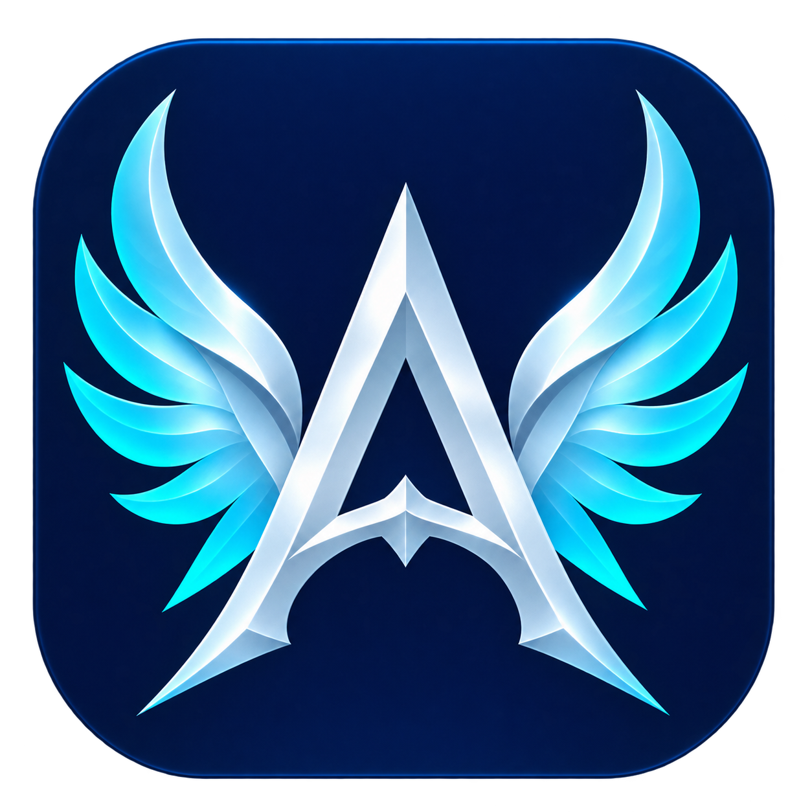
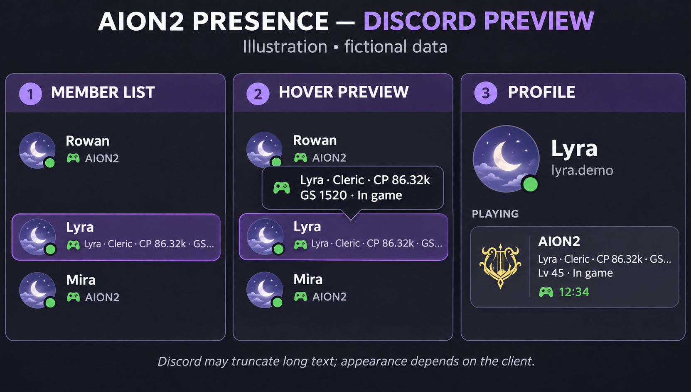

# AION2 Presence



[Polski](README.pl.md) | **English**

A standalone Windows app that shows your AION 2 character, stats and current activity on Discord.

Example status below your name:

`Lyra · Cleric · CP 86.32k · GS 1520 · In game`

The app runs in the background, reads character information through Npcap and updates your Discord activity.

## Detected activities

| Activity | Example Discord status |
| --- | --- |
| Recognized dungeon | `Dungeon name (difficulty)` |
| Fighting a recognized boss in a dungeon | `Dungeon name (difficulty) · Fighting Boss name` |
| Fighting a recognized boss outside a dungeon | `Fighting Boss name` |
| Crafting, after a confirmed completed craft | `Crafting` |
| Gathering resources | `Gathering` |
| Shugo competition — experimental, 9 competitions for both factions | `Shugo Festival · Defend Shugo Merchants` |
| No recognized activity | `In game` |

Dungeon and boss names are filled in from recognized game data. Boss combat takes priority over recent crafting or gathering. AFK and open-world locations are not detected.

Dungeon names require a captured map-load message. Party information alone is not treated as your current location. If the app starts mid-session, the name may remain unavailable until the next map load; a departure or transition clears the previous location.

## Discord examples



The illustration follows observed Discord layouts using fictional names, avatars and statistics. It shows the **member list**, the **hover tooltip** without voice information, and the **profile activity card**. CP/GS appear once in the profile's text lines; the second line shows level and activity. Long text can be truncated by Discord. This is an illustrative mockup, not a guarantee of identical rendering on every client.

## Installation

1. Open **[Releases](https://github.com/Kooowal-design/aion2-presence/releases)** and download the latest installer.
2. Exit any running copy from its system tray menu. Run `Aion2Presence-Setup.exe`, choose your installation folder and select **Install**.
3. Launch **AION2 Presence** from the desktop shortcut or Windows Start menu.
4. AION 2 and Discord desktop must run on the same computer. [Npcap](https://npcap.com/#download) is required to read game traffic. If it is already installed, you do not need to install it again.
5. Enable activity sharing in Discord. You do not need to create a Discord application, enter a token or sign in to Discord through this app.

**If AION 2 reports an error when you try to launch it:** exit AION2 Presence from its system tray menu, start **AION 2 first**, wait for the game window to appear, and then launch **AION2 Presence**. In this case, disable **Start with Windows** and keep that startup order on subsequent launches as well.

You can leave ExitLag enabled. Capture supports network adapters and loopback traffic.

For cloud PCs, install and run the app inside the same Windows session as the game and Discord.

If the app starts after you have logged into your character, details may remain unavailable until the game sends another character identity message, for example when entering the world or teleporting. Values that have not been received stay hidden.

Use only one app to publish AION 2 activity to Discord so that statuses do not overwrite each other.

The installer and app support **English / Polski**. Use the language selector to switch instantly; your choice is remembered. English is the default.

## Automatic features

- Your character's name, class, level, CP and GS, when supplied by the game.
- During combat: the recognized dungeon, difficulty and boss. After combat: the dungeon. Outside a recognized instance: `In game`.
- Additional stats in the profile activity card and image tooltip.
- Activity cleared when the game closes, the capture engine stops responding or the app exits.
- Minimize to the system tray, with optional launch at Windows startup.

Gathering is detected from start/result messages and expires after 15/8 seconds without another event. Crafting is shown for 20 seconds after a confirmed completed craft; merely opening the recipe window does not activate it. Boss combat takes priority.

Experimental Shugo support identifies nine competitions on Elyos and Asmodian maps: Jump Jump, Mysterious Track, Odyle Flight Frenzy, Defend Shugo Merchants, Not This Tile?, Wraith Evasion, Hidden Lugi, Goldrin's Treasure and Up! Up! Up! The status includes the competition name after a known venue map or active run is received. Schedule broadcasts alone do not activate it. Run deadlines are capped at 20 minutes; without a deadline the lease is 10 minutes, and map-only detection lasts at most 20 minutes. Completion or departure clears the event. Live verification is still needed; see [Shugo detection and sources](docs/SHUGO.md).

Outside recognized dungeon/boss activity, gathering, recent crafting or that confirmed Shugo run, the status is `In game`. Open-world locations and **AFK are not detected**.

Discord controls placement and truncation of long text, as well as which activity is shown when several are active. The local preview is illustrative; check the actual display in Discord.

## Feedback

Use **Report a bug** or **Suggest a feature** in the app or system tray menu. The button opens the corresponding GitHub form; bug reports prefill only the app version. A GitHub account is required to submit. Nothing is submitted automatically, and no character data, capture data or logs are attached. You can write in English or Polish.

You can also open [Issues](https://github.com/Kooowal-design/aion2-presence/issues/new/choose) directly. Remove private information from screenshots before posting.

## Updates

The app checks this project's public GitHub releases at startup and every six hours. A new-version link appears in the window and a notification is shown in the system tray. You can also check manually from the tray menu.

Select **Download and install** to start an update. The app downloads the installer from this repository, verifies its SHA-256 checksum, closes the running copy and opens the installer. Settings and the installation folder are retained. Installation requires your confirmation; it does not run silently. Updates currently include newer beta releases while you use a beta version. An unsuccessful check does not interrupt game capture.

Versions before 0.2.0-beta.5 need one manual update to receive this feature. Files are still unsigned; checksum verification does not replace a digital signature.

## Privacy and data

There is no app server, account, telemetry, combat-log upload or raw-packet recording. The parser reads traffic through Npcap, and the app passes selected information to the local Discord client. Visibility follows your Discord activity-sharing settings. Unavailable fields are omitted.

Update checks contact GitHub at startup and every six hours; downloads start only when you request them. No character data, settings or logs are sent. GitHub receives standard connection information such as your IP address.

Settings are stored in `%LOCALAPPDATA%\Aion2Presence`. To uninstall, exit the app from the system tray, disable its Windows startup option, and remove that folder and the chosen installation folder, plus the desktop and Start menu shortcuts.

## Game rules

AION2 Presence uses passive network capture through Npcap, the same approach used by Npcap-based DPS meters. It reads game data to update your Discord activity without modifying game files or memory, injecting packets or automating gameplay. This is an unofficial community project — use it at your own risk and follow the game's rules.

## Building

Development requirements: .NET SDK 10, Rust stable and a linker for your Windows target.

```powershell
git clone --recurse-submodules https://github.com/Kooowal-design/aion2-presence.git
cd aion2-presence
.\build.ps1
```

GitHub Actions builds the Windows installer, runs the checks and publishes a release. Builds can also be started manually from Actions.

## Distribution

The installer carries license notices and writes them beside the installed executable. **Licenses & source** is available in the app and system tray menu. Releases also include a Windows ZIP with notices and a matching source ZIP containing the pinned parser and bundled Rust dependency source archives. Npcap is not included and must be obtained separately. The self-contained Windows build does not require installing .NET.

## License

GPL-3.0. Component and source attribution is provided in [NOTICE.md](NOTICE.md).

Beta: compatibility with your game configuration and the actual Discord display require verification in a live session. The Windows executable is not digitally signed; Windows may show an unknown-publisher warning.
