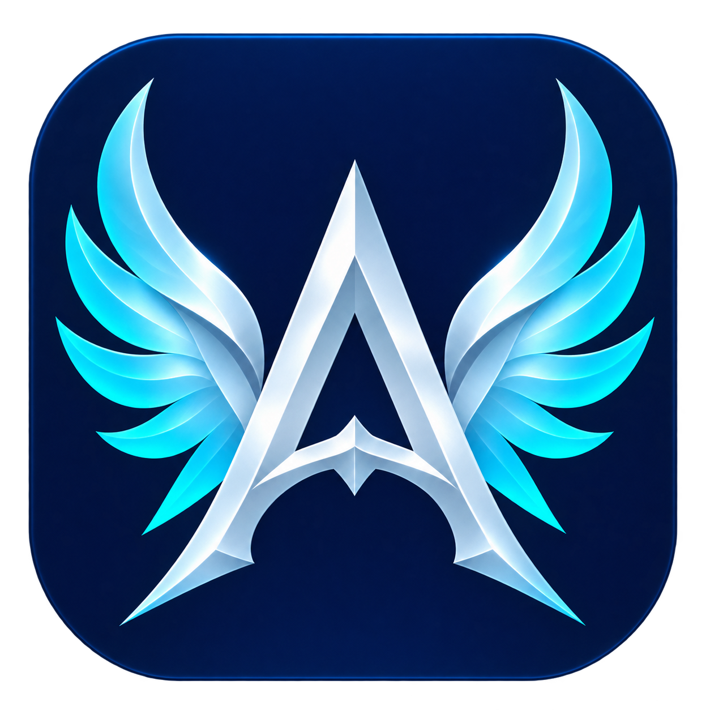
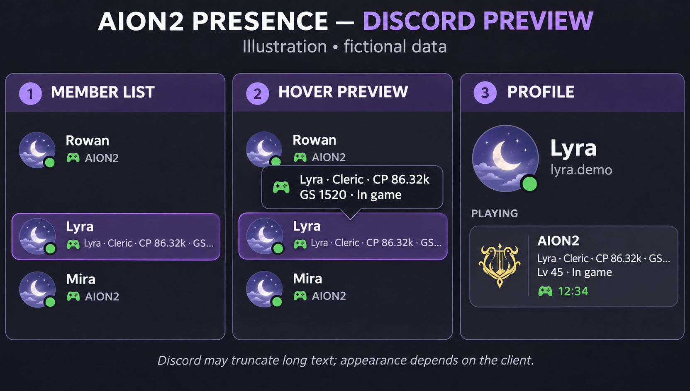

# AION2 Presence



**Polski** | [English](README.md)

Samodzielna aplikacja Windows pokazująca Twoją postać, statystyki i aktualną aktywność w AION 2 na Discordzie.

Domyślny tekst pod nickiem:

`Lyra · Cleric · CP 86.32k · GS 1520 · In game`

Działa w tle, odczytując informacje o Twojej postaci przez Npcap i aktualizując status Discorda.

## Wykrywane aktywności

| Aktywność | Przykładowy status na Discordzie |
| --- | --- |
| Rozpoznany dungeon | `Nazwa dungeona (poziom trudności)` |
| Walka z rozpoznanym bossem w dungeonie | `Nazwa dungeona (poziom trudności) · Fighting Nazwa bossa` |
| Walka z rozpoznanym bossem poza dungeonem | `Fighting Nazwa bossa` |
| Zbieranie surowców | `Gathering` |
| Konkurencja Shugo — eksperymentalnie, 9 konkurencji obu frakcji | `Shugo Festival · Defend Shugo Merchants` |
| Brak rozpoznanej aktywności | `In game` |

Nazwy dungeona i bossa pochodzą z rozpoznanych danych gry. Walka z bossem ma pierwszeństwo przed zbieraniem. AFK i lokacje otwartego świata nie są wykrywane. Tekst aktywności wysyłany na Discord pozostaje angielski.

Nazwa dungeona wymaga odebrania komunikatu wczytania mapy. Sama informacja o grupie nie jest traktowana jako Twoja aktualna lokalizacja. Po uruchomieniu aplikacji w trakcie sesji nazwa może pojawić się dopiero przy kolejnym wczytaniu mapy; sygnał wyjścia lub przejścia czyści poprzednią lokalizację.

## Przykłady na Discordzie



Ilustracja odwzorowuje zaobserwowany układ Discorda, używając fikcyjnych nazw, awatarów i statystyk. Pokazuje **listę osób**, **podgląd po najechaniu** bez informacji głosowych oraz **kartę aktywności w profilu**. CP/GS występują raz w liniach tekstu profilu; druga linia pokazuje level i aktywność. Discord może ucinać długi tekst. To ilustracja, nie gwarancja identycznego wyglądu w każdym kliencie.

## Instalacja

1. Otwórz **[Releases](https://github.com/Kooowal-design/aion2-presence/releases)** i pobierz najnowszy instalator.
2. Zakończ działającą aplikację z zasobnika. Pobierz `Aion2Presence-Setup.exe`, uruchom, wybierz folder instalacji i kliknij **Install / Zainstaluj**.
3. Uruchom **AION2 Presence** ze skrótu na pulpicie lub z menu Start.
4. Na tym samym komputerze muszą działać AION 2 i Discord desktop. Do odczytu wymagany jest [Npcap](https://npcap.com/#download). Jeśli jest już zainstalowany, nie trzeba instalować go ponownie.
5. Udostępnianie aktywności w Discordzie musi być włączone. Nie trzeba tworzyć aplikacji Discord, podawać tokena ani logować konta Discord w tej aplikacji.

**Jeśli przy próbie uruchomienia AION 2 pojawia się błąd:** zakończ AION2 Presence przez menu ikony przy zegarku, uruchom **najpierw AION 2**, poczekaj na pojawienie się okna gry, a dopiero potem włącz **AION2 Presence**. W takim przypadku wyłącz **Start z Windows** i zachowuj tę kolejność również przy kolejnych uruchomieniach.

ExitLag można pozostawić włączony. Odczyt obejmuje adaptery sieciowe i loopback.

Jeśli korzystasz z komputera w chmurze, zainstaluj i uruchom aplikację wewnątrz tej samej sesji Windows, w której działają gra i Discord.

Jeśli program wystartował po zalogowaniu postaci, dane mogą pojawić się dopiero po kolejnym komunikacie tożsamości z gry (np. wejściu postaci do świata lub teleportacji). Nie zgaduje CP ani GS — nieodebrane wartości pozostają ukryte.

Uruchom tylko jedną aplikację wysyłającą status AION 2 do Discorda, aby statusy nie nadpisywały się wzajemnie.

## Co jest automatyczne

- Nazwa własnej postaci, klasa, level, CP i GS, gdy gra dostarczy dane.
- Podczas walki: rozpoznany dungeon, tryb i boss. Po walce sam dungeon; poza rozpoznaną instancją `In game`.
- Zachowanie pełniejszych statystyk w karcie profilu i podpowiedzi obrazu.
- Usunięcie statusu po zamknięciu gry, utracie silnika lub wyłączeniu aplikacji.
- Chowanie okna do zasobnika. Autostart z Windows jest opcjonalny.

Instalator i aplikacja obsługują **English / Polski**. Wybór języka jest zapamiętywany; domyślny jest angielski.

Zbieranie jest rozpoznawane po komunikatach rozpoczęcia i wyniku; status wygasa po 15/8 sekundach bez kolejnego zdarzenia. Walka z bossem ma pierwszeństwo.

Eksperymentalny crafting przy stanowisku wymaga prywatnych danych próby i pasującego startu. Mikstury i jedzenie korzystają z tego samego schematu, bez listy przepisów. Po wyniku status utrzymuje się przez 2,5 sekundy pomiędzy próbami automatycznej serii; brak wyniku wygasza próbę po 60 sekundach. Substance Morph jest pomijany. Inne profesje wymagają sprawdzenia w grze. Zobacz [podstawy i ograniczenia](docs/CRAFTING.md).

Eksperymentalna obsługa Shugo rozpoznaje dziewięć konkurencji na mapach Elyosów i Asmodian: Jump Jump, Mysterious Track, Odyle Flight Frenzy, Defend Shugo Merchants, Not This Tile?, Wraith Evasion, Hidden Lugi, Goldrin's Treasure oraz Up! Up! Up! Status zawiera nazwę konkurencji, po rozpoznaniu jej mapy lub aktywnego runu. Sam harmonogram nie uruchamia statusu. Termin runu jest ograniczony do 20 minut; bez terminu status trwa do 10 minut, a sam odczyt mapy daje maksymalnie 20 minut. Koniec runu lub wyjście czyści status. Obsługa wymaga dalszego sprawdzenia w grze; szczegóły i źródła: [wykrywanie Shugo](docs/SHUGO.md).

Poza rozpoznanym dungeonem/bossem, zbieraniem, craftingiem przy stanowisku i tym runem Shugo status to `In game`. **Nie rozpoznajemy lokacji otwartego świata ani AFK.**

Discord dostaje `status_display_type: 2` (Details), co zgodnie z dokumentacją wybiera szczegóły jako tekst na liście członków. Klient Discorda decyduje o miejscu wyświetlania i skracaniu długiego tekstu. Lokalny podgląd nie jest dowodem, że inny użytkownik widzi cały tekst. Ten efekt wymaga sprawdzenia w realnym Discordzie.

## Zgłoszenia i pomysły

Opcje **Zgłoś błąd** i **Zaproponuj funkcję** w aplikacji oraz menu przy zegarku otwierają formularze GitHub. Przy błędzie uzupełniana jest wyłącznie wersja programu. Do wysłania zgłoszenia potrzebujesz konta GitHub. Nic nie jest wysyłane automatycznie; aplikacja nie dołącza danych postaci, przechwyconych danych ani logów. Możesz pisać po polsku lub angielsku.

Formularze są też dostępne bezpośrednio w [Issues](https://github.com/Kooowal-design/aion2-presence/issues/new/choose). Przed dodaniem zrzutu usuń z niego prywatne informacje.

## Aktualizacje

Aplikacja sprawdza publiczne wydania tego projektu na GitHubie przy uruchomieniu i co sześć godzin. Informacja o nowej wersji pojawia się w oknie oraz jako powiadomienie przy zegarze. Aktualizacje można też sprawdzić ręcznie z menu ikony.

Wybierz **Pobierz i zainstaluj**, aby rozpocząć aktualizację. Aplikacja pobierze instalator z tego repozytorium, sprawdzi sumę SHA-256, zakończy działającą kopię i otworzy instalator. Ustawienia i folder instalacji są zachowywane. Instalacja wymaga Twojego potwierdzenia. Wersja beta sprawdza również nowsze wydania beta. Nieudane sprawdzenie nie przerywa odczytu gry.

Wersje starsze niż 0.2.0-beta.5 wymagają jednorazowej ręcznej aktualizacji, aby otrzymać tę funkcję. Pliki nadal nie mają podpisu cyfrowego; sprawdzenie sumy kontrolnej go nie zastępuje.

## Prywatność i dane

Brak serwera aplikacji, konta, telemetryki i automatycznych uploadów. Zwykła aplikacja nie zapisuje surowych pakietów. Osobno uruchamiana diagnostyka craftingu zapisuje pełne przychodzące dane gry lokalnie; mogą one zawierać dane postaci i czat. Niczego nie wysyła automatycznie. Zobacz [zakres diagnostyki](docs/CRAFTING-DIAGNOSTICS.md). Parser czyta ruch przez Npcap, a aplikacja przekazuje wybrane informacje do lokalnego klienta Discorda. Brakujące pola są pomijane.

Sprawdzanie aktualizacji łączy się z GitHubem przy starcie i co sześć godzin. Pobieranie uruchamiasz samodzielnie. Nie wysyłamy danych postaci, ustawień ani logów; GitHub otrzymuje standardowe informacje o połączeniu, takie jak adres IP.

Ustawienia zapisują się w `%LOCALAPPDATA%\Aion2Presence`. Odinstalowanie: zakończ aplikację z zasobnika, wyłącz autostart i usuń ten folder oraz skrót AION2 Presence z menu Start.

## Zasady gry

AION2 Presence korzysta z pasywnego odczytu ruchu sieciowego przez Npcap — na tej samej zasadzie co DPS metery oparte na Npcap. Odczytuje dane gry, aby aktualizować aktywność na Discordzie, bez modyfikowania plików ani pamięci gry, wstrzykiwania pakietów czy automatyzacji rozgrywki. To nieoficjalny projekt społecznościowy — korzystasz z niego na własną odpowiedzialność, z uwzględnieniem zasad gry.

## Budowanie

Wymagania tylko na komputerze programistycznym: .NET SDK 10, Rust stable i linker dla wybranego celu Windows.

```powershell
git clone --recurse-submodules https://github.com/Kooowal-design/aion2-presence.git
cd aion2-presence
.\build.ps1
```

GitHub Actions buduje instalator Windows, uruchamia testy i publikuje wydanie. Budowanie można uruchomić również ręcznie w Actions.

## Dystrybucja

Instalator zawiera informacje licencyjne i zapisuje je obok programu. Opcja **Licencje i źródła** jest dostępna w aplikacji i menu przy zegarku. Wydania zawierają też ZIP programu z licencjami oraz ZIP odpowiadających mu źródeł z przypiętym parserem i archiwami źródeł zależności Rust. Npcap nie jest dołączany — pobiera się go osobno. Paczka Windows zawiera środowisko .NET; nie trzeba go instalować.

## Licencja

GPL-3.0. Informacje o komponentach i pochodzeniu kodu: [NOTICE.md](NOTICE.md).

Pierwsza wersja: zgodność z konkretną konfiguracją gry i wygląd statusu wymagają sprawdzenia w rzeczywistej sesji.
