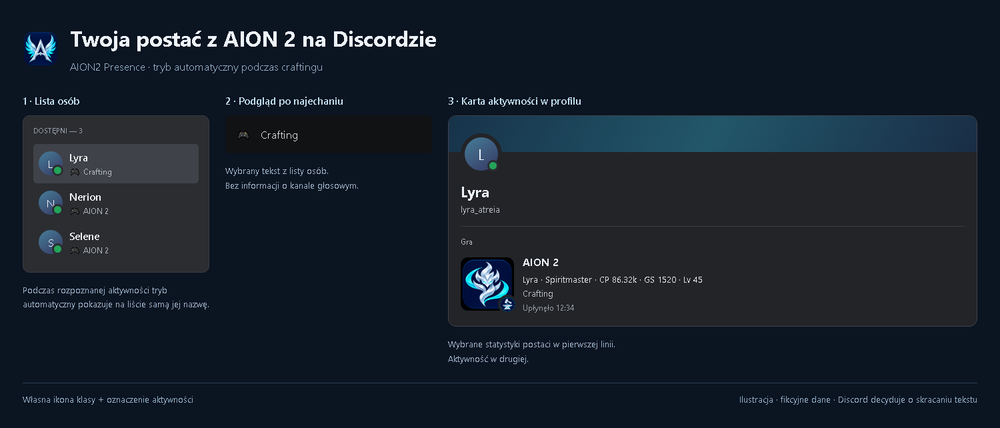
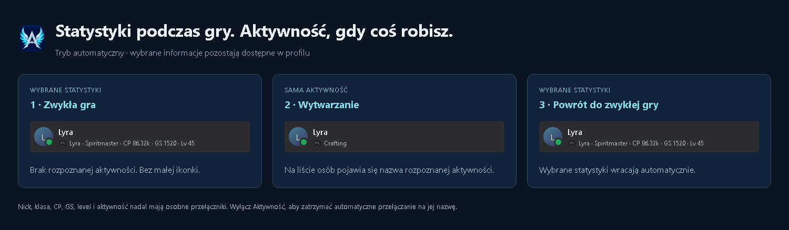
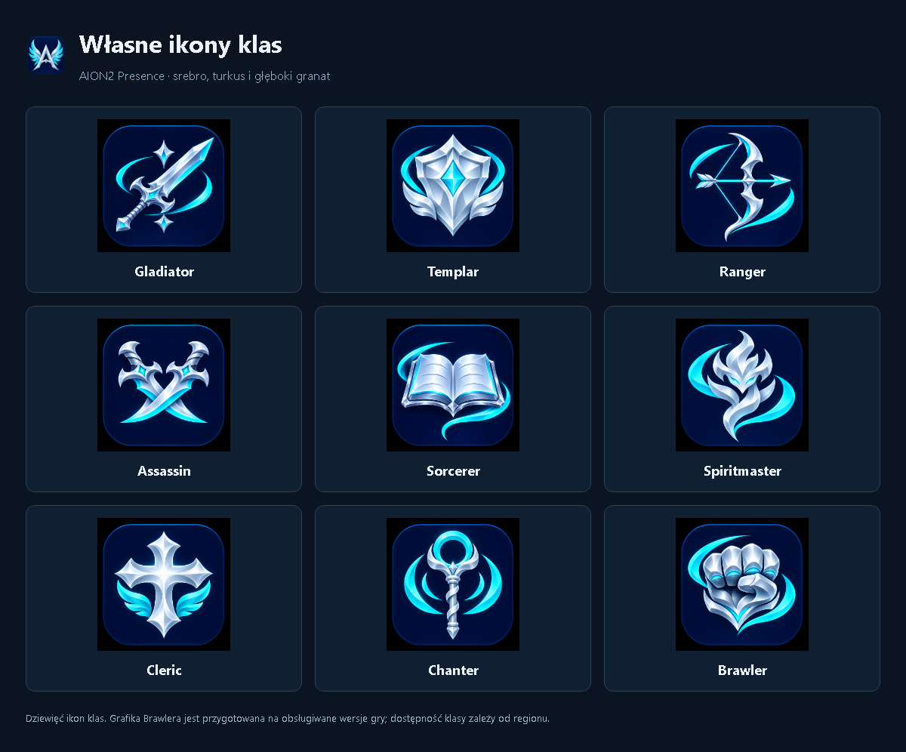
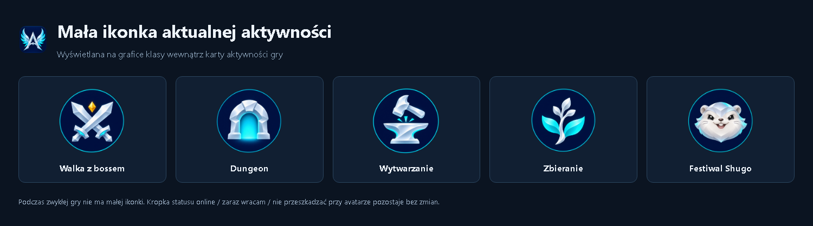

# AION2 Presence


**Polski** | [English](README.md)

**Twoja postać i aktywność w AION 2 na Discordzie.**

Bezpłatna aplikacja Windows z otwartym kodem, pokazująca statystyki postaci i to, co robisz w grze. Działa samodzielnie w tle. Nie wymaga uruchomionego DPS metera, tokena Discord ani konfiguracji w Developer Portal.

**[Pobierz na Windows](https://github.com/Kooowal-design/aion2-presence/releases/tag/v0.2.0-beta.13)** · **[Wszystkie wersje](https://github.com/Kooowal-design/aion2-presence/tags)** · **[Zgłoś błąd](https://github.com/Kooowal-design/aion2-presence/issues/new/choose)**

## Jak wygląda na Discordzie



Na **liście osób** mogą pojawiać się wybrane statystyki albo aktualna aktywność. **Podgląd po najechaniu** rozwija wybrany tekst listy, a **karta aktywności w profilu** zachowuje wybrane dane postaci i aktywność w dwóch osobnych liniach.

```text
Lyra · Spiritmaster · CP 86.32k · GS 1520 · Lv 45
Crafting
```

Ilustracje używają fikcyjnych nazw i statystyk. Discord decyduje o układzie, skracaniu tekstu oraz pierwszeństwie aktywności. Podpisy ilustracji są po polsku. Nazwy klas i statusy na pokazanej karcie pozostają zgodne z angielskim tekstem aplikacji.

## Wybierz, co pokazywać

Każde pole ma własny przełącznik: **nick, klasa, CP, GS, level i aktywność**. Wybrane dane postaci trafiają do pierwszej linii profilu, a aktywność do drugiej. Level pojawia się w pierwszej linii, jeśli jest włączony.

| Tryb listy osób | Tekst pod nickiem |
| --- | --- |
| **Automatycznie — domyślnie** | Wybrane statystyki podczas zwykłej gry; sama rozpoznana aktywność, gdy trwa. |
| **Wybrane statystyki** | Wybrane dane postaci, także podczas aktywności. |
| **Sama aktywność** | Aktualna aktywność albo `AION 2 - In game`, jeśli żadna nie została rozpoznana. |
| **Tylko AION 2** | Sama nazwa `AION 2`; wybrane szczegóły pozostają w profilu. |



Wyłączenie **Aktywności** ukrywa jej tekst i małą ikonę oraz zatrzymuje automatyczne przełączanie listy na aktywność. Ukryte pola tekstowe znikają również z podpowiedzi po najechaniu na grafikę. Jeśli nie wybierzesz żadnych pól, lista pokazuje `AION 2`.

## Własne ikony klas i aktywności



Duża grafika oznacza klasę. Zestaw zawiera Gladiatora, Templara, Rangera, Assassina, Sorcerera, Spiritmastera, Clerica, Chantera i Brawlera. Grafika Brawlera jest przygotowana na obsługiwane wersje gry i nie oznacza dostępności klasy w każdym regionie.



Mały znaczek w rogu **grafiki klasy wewnątrz karty gry** oznacza walkę z bossem, dungeon, crafting, gathering lub Shugo. Podczas zwykłej gry małego znaczka nie ma. **Nie zastępuje on kropki online/idle/DND przy avatarze użytkownika.** Grafiki znajdują się w publicznym repozytorium tego projektu i są wczytywane przez Discorda.

## Wykrywane aktywności

| Aktywność | Przykładowy status |
| --- | --- |
| Rozpoznany dungeon | `Dungeon name (difficulty)` |
| Walka z rozpoznanym bossem w dungeonie | `Dungeon name (difficulty) · Fighting Boss name` |
| Walka z rozpoznanym bossem otwartego świata | `Fighting Boss name` |
| Zbieranie surowców | `Gathering` |
| Crafting, w tym automatyczne serie | `Crafting` |
| Konkurencja Shugo — eksperymentalnie, obie frakcje | `Shugo Festival · Defend Shugo Merchants` |
| Brak rozpoznanej aktywności | `AION 2 - In game` albo wybrane statystyki na liście w trybie automatycznym |

Nazwy dungeonów i bossów pochodzą z rozpoznanych danych gry. **Wykrywanie bossa zależy od danych NPC dołączonych do aplikacji oraz odebranych danych walki. Niektóre bossy mogą nie zostać rozpoznane.** Dotyczy to zarówno dungeonów, jak i otwartego świata.

Nazwa dungeona wymaga odebrania komunikatu wczytania mapy. Sama informacja o grupie nie potwierdza lokalizacji. Po uruchomieniu aplikacji w trakcie sesji może być potrzebne kolejne wczytanie mapy. Wyjście lub przejście czyści poprzednią lokalizację.

Crafting włącza się po rozpoczęciu wytwarzania, także przy automatycznych seriach. Samo otwarcie okna przepisów nie uruchamia statusu. Nie ma konfiguracji dla każdego przepisu; Substance Morph jest pomijany. Zobacz [zakres sprawdzenia i ograniczenia](docs/CRAFTING.md).

Eksperymentalna obsługa Shugo obejmuje dziewięć nazwanych konkurencji na mapach Elyosów i Asmodian. Udział jest rozpoznawany z mapy konkurencji lub aktywnego runu; sam harmonogram nie wystarcza. Szczegóły: [wykrywanie Shugo](docs/SHUGO.md).

Walka z bossem ma pierwszeństwo przed zbieraniem i craftingiem. **Nie wykrywamy AFK ani nazw lokacji otwartego świata.** Tekst aktywności na Discordzie pozostaje angielski.

## Instalacja

1. Otwórz **[bieżące wydanie](https://github.com/Kooowal-design/aion2-presence/releases/tag/v0.2.0-beta.13)** i pobierz **Aion2Presence-Setup.exe**. **[Wszystkie wersje](https://github.com/Kooowal-design/aion2-presence/tags)** znajdziesz w Tags; opcja **Downloads** przy danej wersji prowadzi do plików wydania.
2. Przy ręcznej aktualizacji zakończ działającą kopię z menu ikony przy zegarku. Uruchom instalator, wybierz folder i kliknij **Zainstaluj**.
3. Włącz **AION2 Presence** ze skrótu na pulpicie lub z menu Start.
4. Uruchom AION 2 i Discord desktop na tym samym komputerze. Wymagany jest [Npcap](https://npcap.com/#download); istniejącą instalację można wykorzystać ponownie.
5. Włącz udostępnianie aktywności w Discordzie. Nie trzeba tworzyć aplikacji Discord, podawać tokena ani logować się przez Presence.

**Jeśli AION 2 zgłasza błąd przy uruchamianiu:** zakończ Presence z zasobnika, uruchom **najpierw AION 2**, a potem Presence. Jeśli potrzebujesz tej kolejności, wyłącz **Start z Windows**.

ExitLag może pozostać włączony. Odczyt obsługuje adaptery sieciowe i loopback. Na komputerze w chmurze gra, Discord i Presence muszą działać w tej samej sesji Windows.

Jeśli brakuje danych postaci, poczekaj na wejście do świata lub teleport. Nieodebrane dane pozostają pominięte. Używaj jednej aplikacji wysyłającej status AION 2, aby statusy się nie nadpisywały.

Aplikacja i instalator obsługują **English / Polski**. Nie trzeba oddzielnie instalować .NET. Plik Windows nie ma obecnie podpisu cyfrowego; system może pokazać nieznanego wydawcę.

## Aktualizacje i zgłoszenia

Presence sprawdza wydania tego projektu przy starcie i co sześć godzin. Można też sprawdzić je ręcznie. Zielony panel **Aktualna wersja** pokazuje bieżącą wersję, a złoty **Dostępna aktualizacja** udostępnia **Pobierz i zainstaluj**.

Plik jest weryfikowany sumą SHA-256 przed zamknięciem aplikacji i otwarciem instalatora. Ustawienia i folder instalacji zostają zachowane. Instalacja wymaga potwierdzenia. Nieudane sprawdzanie aktualizacji nie przerywa odczytu gry. Wersje sprzed beta.5 wymagają jednej ręcznej aktualizacji, aby otrzymać updater.

Użyj **Zgłoś błąd** lub **Zaproponuj funkcję** w aplikacji lub menu zasobnika albo otwórz **[GitHub Issues](https://github.com/Kooowal-design/aion2-presence/issues/new/choose)**. Formularz błędu uzupełnia tylko wersję aplikacji; nic nie jest wysyłane automatycznie i nie są dołączane dane postaci ani logi. Wysłanie wymaga konta GitHub. Można pisać po polsku lub angielsku.

## Prywatność i zasady gry

Brak konta aplikacji, serwera aplikacji, telemetryki i uploadu logów walk. Zwykłe Presence nie zapisuje surowych pakietów. Odczytuje ruch gry przez Npcap i przekazuje wybrane informacje do lokalnego Discorda. Widoczność zależy od ustawień udostępniania aktywności Discorda.

Sprawdzanie aktualizacji kontaktuje się z GitHubem bez wysyłania danych postaci, ustawień i logów. GitHub otrzymuje zwykłe informacje połączenia, np. adres IP. Ustawienia zapisują się w `%LOCALAPPDATA%\Aion2Presence`.

Opcjonalna, oddzielnie uruchamiana [diagnostyka craftingu](docs/CRAFTING-DIAGNOSTICS.md) zapisuje przychodzące dane gry lokalnie i może zawierać dane postaci oraz czat. Nie wysyła ich automatycznie i nie działa w zwykłym trybie aplikacji.

Presence korzysta z pasywnego odczytu Npcap, tak jak DPS metery oparte na Npcap. Nie modyfikuje plików ani pamięci gry, nie wstrzykuje pakietów i nie automatyzuje rozgrywki. To nieoficjalny projekt społecznościowy — korzystasz na własną odpowiedzialność i zgodnie z zasadami gry.

Aby odinstalować: zakończ program z zasobnika, wyłącz autostart, usuń folder instalacji, folder ustawień i skróty z pulpitu oraz menu Start.

## Kod i licencja

GPL-3.0. Informacje o komponentach znajdują się w [NOTICE.md](NOTICE.md). **Licencje i źródła** są dostępne w aplikacji i zasobniku. Wydania zawierają licencje, sumy SHA-256 i pasujące archiwum źródeł z przypiętym parserem oraz źródłami zależności Rust. Npcap nie jest dołączony.

Do budowania: .NET SDK 10, Rust stable i linker dla docelowego Windows.

```powershell
git clone --recurse-submodules https://github.com/Kooowal-design/aion2-presence.git
cd aion2-presence
.\build.ps1
```

Publiczna beta: zgodność z konfiguracją i końcowy wygląd w Discordzie należy sprawdzić w rzeczywistej sesji gry.
